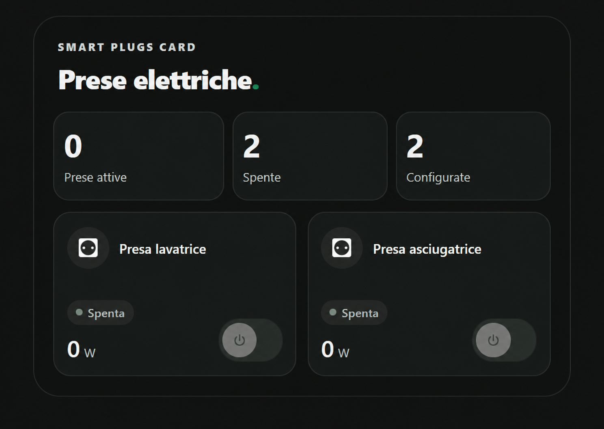

# Smart Plugs Card

[](https://www.tiktok.com/@luigi.regolo)
[](LICENSE)
[](https://my.home-assistant.io/redirect/hacs_repository/?owner=luigi-regolo&repository=smart-plugs-card&category=plugin)
[](https://github.com/luigi-regolo/smart-plugs-card/stargazers)

## Overview

**Smart Plugs Card** is a custom dashboard card for Home Assistant that brings multiple smart plugs into a compact, responsive interface inspired by the Edera Light and Graphite Dark styles.

It displays each configured plug's current state, provides optional on/off controls, and shows power and energy readings when compatible sensors are available. The card uses existing Home Assistant entities and services; it does not communicate directly with smart plugs or require a separate cloud account.

## Preview



*Smart Plugs Card in Graphite Dark mode. Names and readings depend on the Home Assistant configuration.*

## Features

- **Multiple plugs:** Add, rename, reorder, and remove smart plugs using the visual editor.
- **Individual states:** Distinguish on, off, and unknown/unavailable states.
- **On/off controls:** Switch compatible `switch.*` entities on or off when real controls have been explicitly enabled.
- **State summary:** Count the configured plugs that are on, off, or whose state is unavailable.
- **Optional summary sensor:** Show an independent numeric `sensor.*` value, such as the number of active plugs. This value may cover devices outside the card.
- **Power monitoring:** Display instantaneous power in W when a compatible `sensor.*` entity is configured (`W` and `kW` supported).
- **Optional energy reading:** Display energy in kWh when a compatible energy sensor is configured (`Wh`, `kWh`, and `MWh` supported).
- **Visual configuration:** Native Home Assistant entity selectors when available, with an entity-list fallback.
- **Edera appearance:** Automatic, Light, and Graphite Dark themes; a subtle green tile highlight for active plugs in Light mode, and neutral tiles with green switches in Dark mode; configurable Home Assistant MDI icons.
- **Optional headings:** Show or hide the upper label and main title independently.
- **Responsive design:** Two-column grid on supported narrow dashboard layouts, including smartphones, with a separate compact list option.
- **No detail popups:** Switching and status information stay in the card itself.

The available measurements and controls depend on the configured Home Assistant devices and integrations. Unknown or unavailable states are not interpreted as off.

## Installation

### HACS — Custom repository

Install Smart Plugs Card through **Custom repositories** in HACS. Choose the **Dashboard** repository category.

1. Open **HACS** in Home Assistant.
2. Open the HACS menu and choose **Custom repositories**.
3. Enter `https://github.com/luigi-regolo/smart-plugs-card`.
4. Select **Dashboard** as the repository type and add it.
5. Find **Smart Plugs Card** in HACS and download it.
6. Reload the dashboard if necessary, then add the card using the dashboard editor.

### Manual installation

1. Download `dist/smart-plugs-card.js` from this repository.
2. Copy the file to the `www` directory in your Home Assistant configuration as `smart-plugs-card.js`.
3. In Home Assistant, open **Settings → Dashboards → Resources**.
4. Add `/local/smart-plugs-card.js` with resource type **JavaScript module**.
5. Reload the dashboard and add **Smart Plugs Card**.

If the `www` directory has just been created, Home Assistant may need a restart before the resource becomes available.

## Configuration and Usage

### Visual editor

After adding the card, use the editor sections:

- **Plugs:** Add smart plugs, select their controllable `switch.*` entities, set display names and rooms, choose MDI icons, and optionally assign power/energy sensors. Configure an optional independent summary sensor.
- **Appearance:** Show or hide either heading, change their text, choose Automatic/Light/Dark appearance, switch between grid and compact list, and show or hide W and kWh readings.
- **Advanced:** Enable the real on/off controls. Controls are **disabled by default**.

The entity pickers restrict plug controls to `switch.*` entities and measurement sensors to `sensor.*` entities with the relevant power or energy device class. The optional summary sensor is selected separately from the individual plug states.

### Example YAML configuration

The visual editor is recommended; YAML is optional. The identifiers below are fictional examples:

```yaml
type: custom:smart-plugs-card
title: Smart Plugs
eyebrow: SMART PLUGS CARD
show_title: true
show_eyebrow: true
theme_mode: auto
layout: grid
show_power: true
show_energy: false
controls_enabled: false
plugs:
  - name: Washing machine
    room: Laundry
    icon: mdi:washing-machine
    entity: switch.example_washing_machine
    power_entity: sensor.example_washing_machine_power
```

Replace the example entities with entities actually present in Home Assistant. An energy sensor or external active-plug count is optional.

### Main configuration options

| Option | Description |
|---|---|
| `title` / `eyebrow` | Main title and upper label. |
| `show_title` / `show_eyebrow` | Show or hide the two headings independently. |
| `theme_mode` | `auto`, `light`, or `dark`. |
| `layout` | `grid` or `list`. |
| `show_power` / `show_energy` | Show optional power and energy values. |
| `active_sensor` | Optional numeric `sensor.*` count shown separately. |
| `controls_enabled` | Enable real on/off commands; defaults to `false`. |
| `plugs` | List of individually configured smart plugs. |

Each entry in `plugs` supports `name`, `room`, `icon`, `entity`, `power_entity`, and `energy_entity`.

## Compatibility and Requirements

- Home Assistant with support for custom JavaScript dashboard modules.
- A `switch.*` entity for each plug to be controlled or monitored.
- Optional compatible `sensor.*` entities for power, energy, or an independent count.
- HACS is needed only for installation through HACS.

No specific minimum Home Assistant version has been independently verified. The card has no additional external JavaScript libraries, dedicated paid API, or subscription requirement. Individual plug integrations may use their manufacturers' cloud services.

## Privacy and Security

Smart Plugs Card reads configured Home Assistant entities and uses Home Assistant's existing service calls and user permissions. It does not implement telemetry, advertising, analytics, external JavaScript loading, or direct third-party requests.

- Real commands are disabled by default and require explicit activation in the card editor.
- Only valid configured `switch.*` entities are targeted for `switch.turn_on` and `switch.turn_off`.
- Unknown and unavailable states disable the corresponding switch control.
- The card does not provide separate authentication or override Home Assistant permissions.
- Do not use remote switching for appliances where unexpected activation or loss of power could create a safety risk.

## Copyright & License

Copyright © 2026 luigi-regolo.

Original project created and maintained by **luigi-regolo**.

Licensed under the **GNU General Public License version 3 only (GPL-3.0-only)**. See the [LICENSE](LICENSE) file for the complete license terms.

The software is provided without warranty to the extent permitted by applicable law.
